

  <a href="https://panic-study-room.vercel.app">
    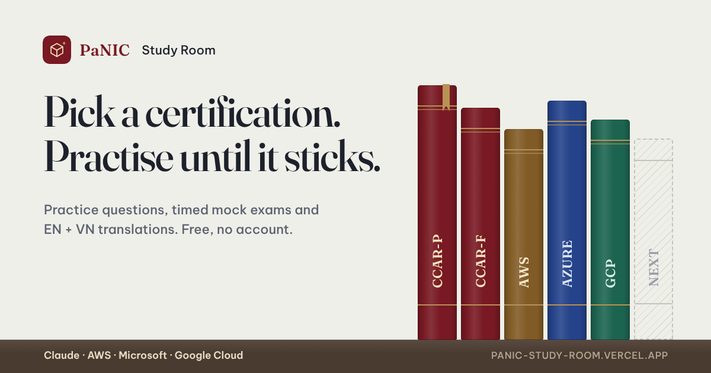
  </a>

<h1 align="center">PaNIC Study Room</h1>

  Một phòng học yên tĩnh để ôn thi chứng chỉ — luyện từng câu có giải thích, thi thử có giờ, 
  song ngữ Anh – Việt và theo dõi tiến độ mỗi ngày.

  <a href="https://panic-study-room.vercel.app"><b>Mở website →</b></a>
  &nbsp;·&nbsp; Miễn phí &nbsp;·&nbsp; Không cần tài khoản

---

## Dành cho ai?

Cho người đang chuẩn bị thi một chứng chỉ chuyên môn và muốn **hiểu vì sao đáp án đúng**, chứ không chỉ học thuộc. Mỗi câu hỏi được trình bày như một bài đọc: đọc kỹ, chọn đáp án, xem ngay đúng hay sai và lý do. Khi đã sẵn sàng, bạn bước vào một bài thi thử có đồng hồ để biết mình đang ở đâu.

Hiện mở hai phòng học cho chứng chỉ **Claude Certified Architect** (Professional và Foundations). Các chứng chỉ của **AWS**, **Microsoft** và **Google Cloud** đã có chỗ trên kệ và sẽ lần lượt mở.

## Mục lục

- [Thư viện chứng chỉ](#thư-viện-chứng-chỉ)
- [Trang chứng chỉ](#trang-chứng-chỉ)
- [Luyện tập từng câu](#luyện-tập-từng-câu)
- [Song ngữ Anh – Việt](#song-ngữ-anh--việt)
- [Gợi ý từ khoá](#gợi-ý-từ-khoá)
- [Ôn lại câu sai và câu đã đánh dấu](#ôn-lại-câu-sai-và-câu-đã-đánh-dấu)
- [Thi thử có giờ](#thi-thử-có-giờ)
- [Tiến độ và thói quen học](#tiến-độ-và-thói-quen-học)
- [Tìm nhanh, chế độ tối, điện thoại](#tìm-nhanh-chế-độ-tối-điện-thoại)
- [Phím tắt](#phím-tắt)

---

## Thư viện chứng chỉ

Trang chủ là một **giá sách**: mỗi chứng chỉ là một cuốn, xếp theo từng hãng. Sách có màu là phòng học đã mở, sách nhạt đang được chuẩn bị, sách viền đứt nằm trong kế hoạch. Gáy sách được tô dần theo phần trăm bạn đã làm, và cuốn bạn học gần nhất có một dải ruy băng đánh dấu.

Người quay lại sẽ thấy ngay ô **Pick up where you left off** — bấm *Continue* là về đúng câu đang làm dở — cùng mục tiêu hôm nay và chuỗi ngày học liên tiếp.

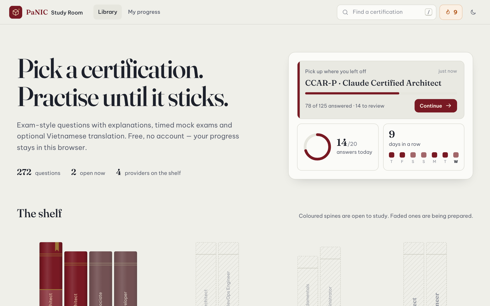

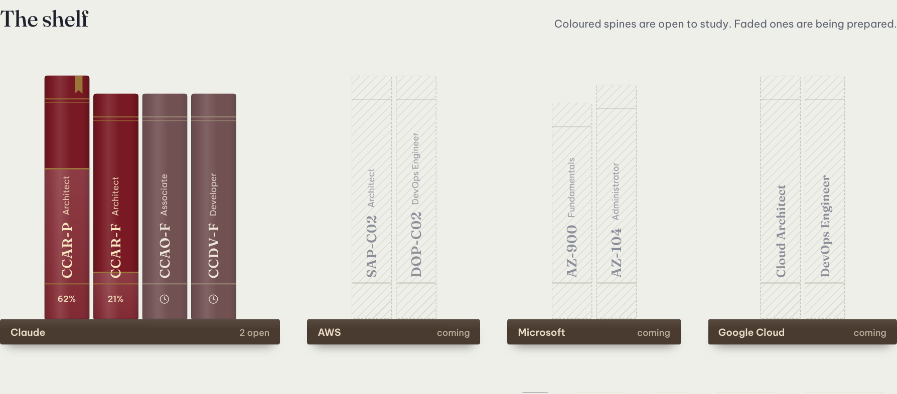

## Trang chứng chỉ

Mỗi chứng chỉ có một trang tổng quan: số câu hỏi, cấu hình bài thi thử, ngôn ngữ và ngày cập nhật bộ câu hỏi. Bên dưới là bức tranh toàn cảnh về việc học của bạn:

- **Vòng tiến độ** và số câu đúng, sai, độ chính xác.
- **Ôn câu sai** và **câu đã đánh dấu** chỉ với một chạm.
- **Lịch sử thi thử** — mỗi cột là một lần thi, nhìn là thấy mình tiến bộ.
- **Theo từng domain** — tỉ trọng của domain trong đề thi, phần đã làm và tỉ lệ đúng, để biết nên dồn sức vào đâu.

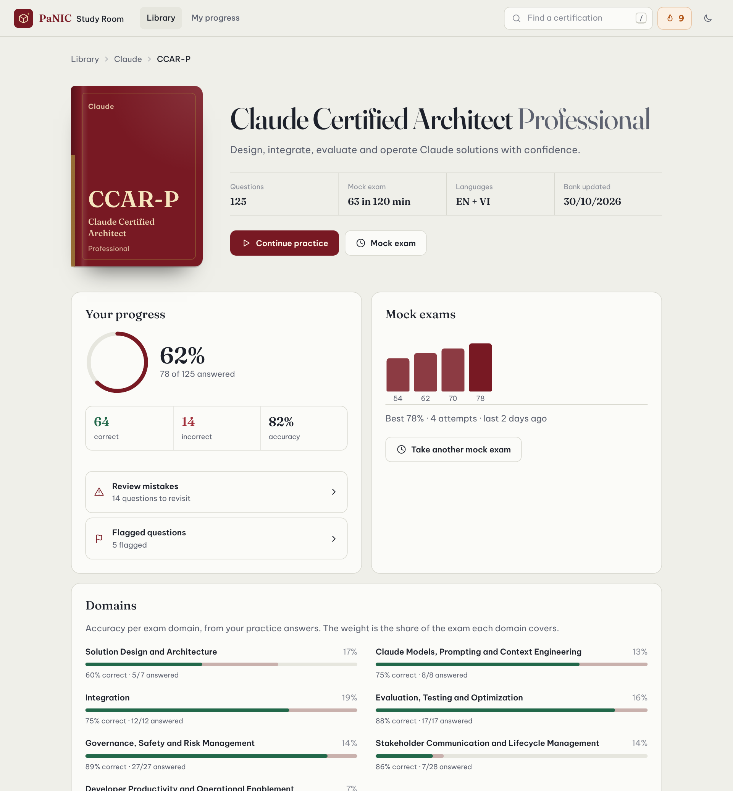

## Luyện tập từng câu

Chọn đáp án là biết ngay đúng hay sai, kèm **lời giải thích** vì sao. Câu nhiều đáp án được chấm khi bạn chọn đủ số đáp án yêu cầu; câu phân loại (Yes/No) được chấm từng dòng. Thứ tự đáp án được xáo mỗi lần quay lại câu, để bạn nhớ nội dung chứ không nhớ vị trí.

Bảng câu hỏi bên trái cho biết câu nào đúng (xanh), sai (đỏ), đã đánh dấu (chấm vàng), và lọc được theo domain, trạng thái hoặc loại câu. Công tắc **Show answers** cho phép đọc lướt toàn bộ đáp án mà không làm thay đổi tiến độ.

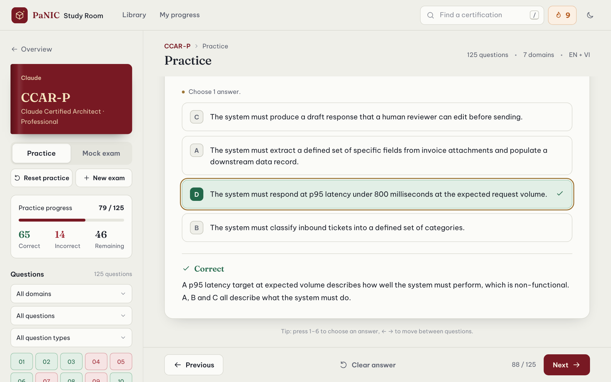

## Song ngữ Anh – Việt

Bật **Tiếng Việt** để xem bản dịch ngay bên dưới câu hỏi, từng đáp án và lời giải thích. Đề gốc tiếng Anh luôn được giữ nguyên, thuật ngữ chuyên môn không bị dịch, nên bạn vừa hiểu nhanh vừa quen với cách ra đề thật.

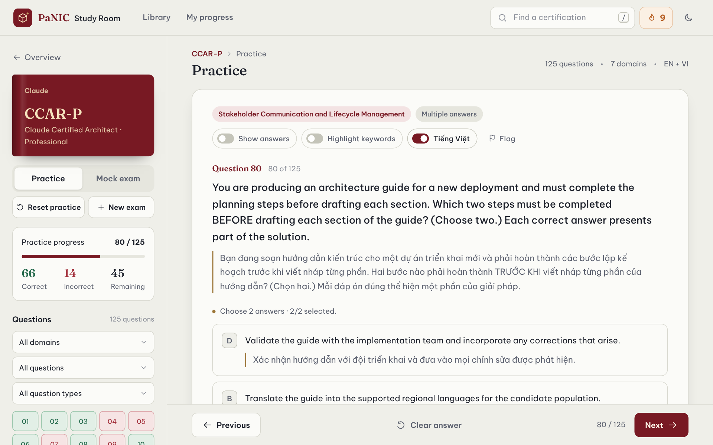

## Gợi ý từ khoá

Với CCAR-P, công tắc **Highlight keywords** tô màu những cụm từ đáng chú ý trong các đáp án: **xanh** là dấu hiệu của hướng đúng, **đỏ** là dấu hiệu nên tránh, **vàng** là chỗ cần đọc kỹ. Đây là gợi ý cách đọc đề, không phải đáp án.

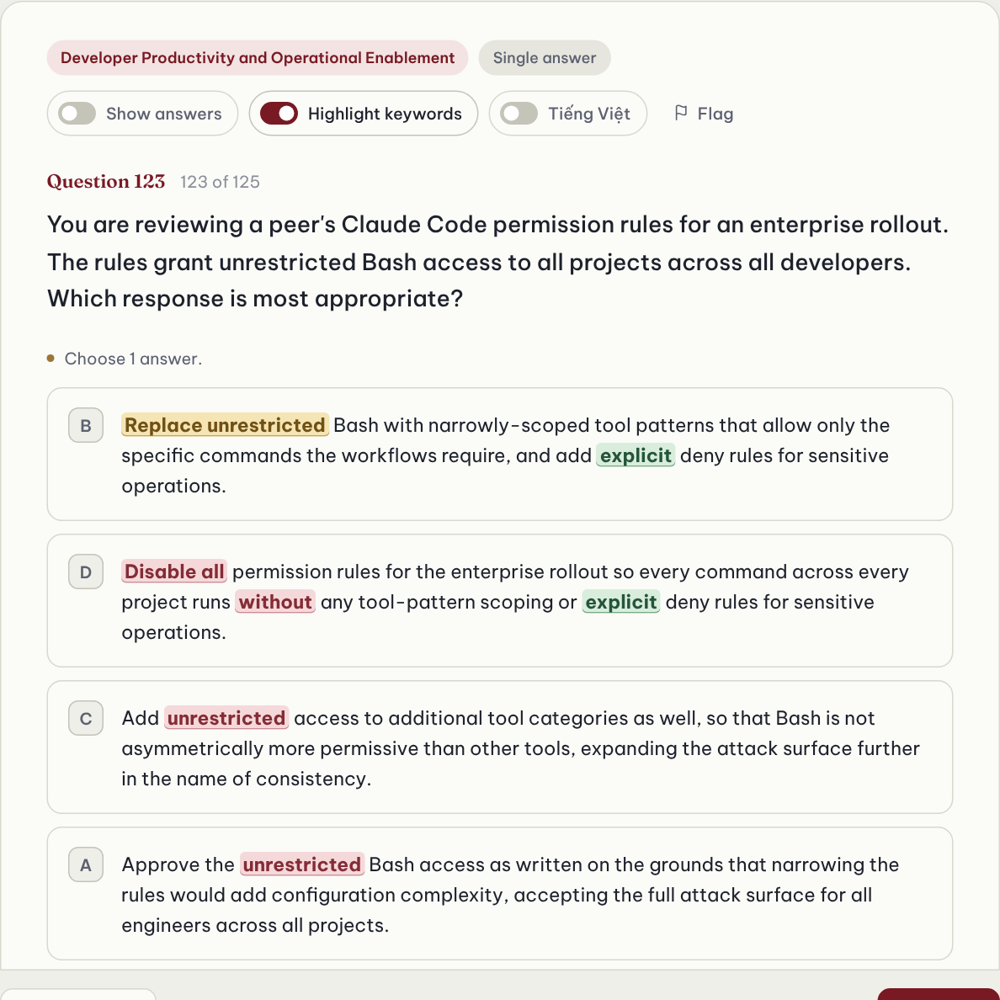

## Ôn lại câu sai và câu đã đánh dấu

Mọi câu trả lời sai tự động gom lại một chỗ. Ở chế độ **Reviewing your mistakes**, nút *Next* chỉ nhảy giữa các câu sai — làm đúng rồi thì câu đó tự rời khỏi danh sách. Câu nào muốn xem lại sau, chỉ cần bấm **Flag**.

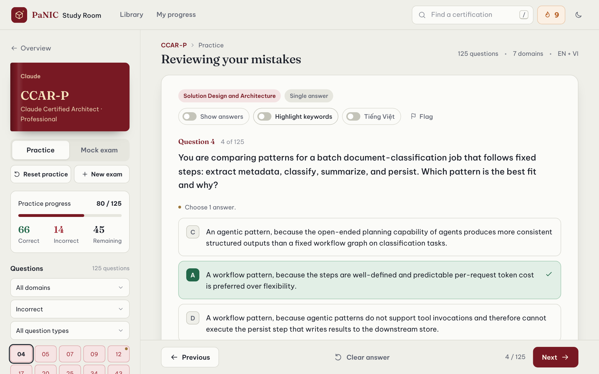

## Thi thử có giờ

Bài thi thử chọn ngẫu nhiên câu hỏi, xáo đáp án, có đồng hồ đếm ngược và **chỉ chấm khi nộp bài** — giống như ngày thi thật. Đồng hồ vẫn chạy khi tải lại trang hay chuyển ứng dụng; hết giờ bài tự nộp. Muốn luyện nhẹ hơn, chọn **Untimed range** để làm một đoạn câu hỏi bất kỳ, không giới hạn thời gian.

Sau khi nộp: điểm phần trăm, so sánh với lần thi trước, thời gian làm bài và kết quả theo từng domain. Bấm *Review answers* để xem lại từng câu kèm đáp án đúng.

<table>
  <tr>
    <td width="58%">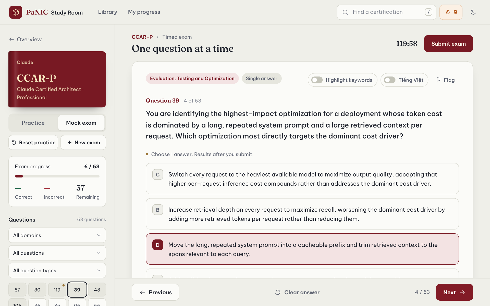</td>
    <td width="42%">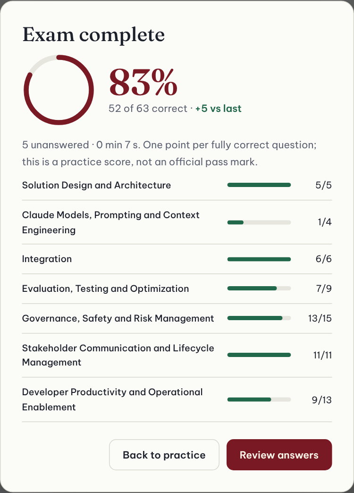</td>
  </tr>
</table>

## Tiến độ và thói quen học

Học đều mỗi ngày quan trọng hơn học dồn. Trang **My progress** gom mọi thứ lại:

- **Chuỗi ngày học** liên tiếp — hiển thị luôn trên thanh trên cùng với biểu tượng ngọn lửa.
- **Mục tiêu mỗi ngày** — chọn 10, 20, 40 hoặc 60 câu; đạt mục tiêu sẽ có lời chúc mừng.
- **Lịch hoạt động 18 tuần** — ô càng đậm là ngày học càng nhiều.
- **Tất cả chứng chỉ** đang học với phần trăm hoàn thành và điểm thi thử gần nhất.

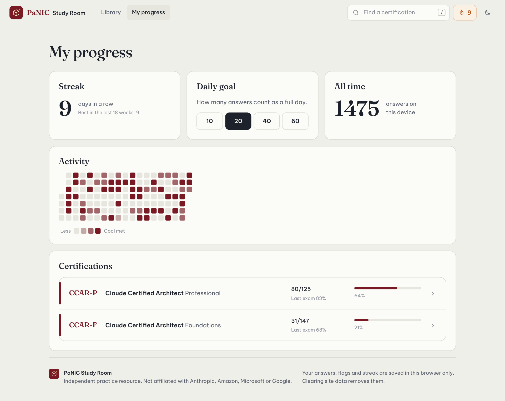

## Tìm nhanh, chế độ tối, điện thoại

**Tìm nhanh** — bấm `/` ở bất kỳ đâu để tìm chứng chỉ theo tên, mã thi hoặc hãng.

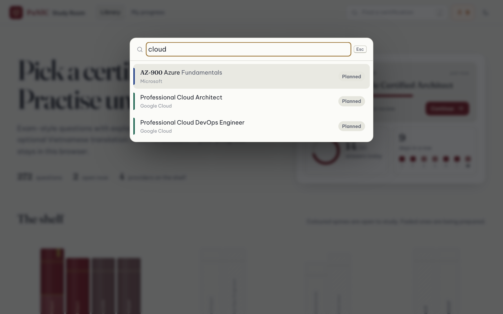

**Chế độ tối** — tự theo cài đặt của máy, hoặc bật/tắt bằng biểu tượng mặt trăng.

<table>
  <tr>
    <td>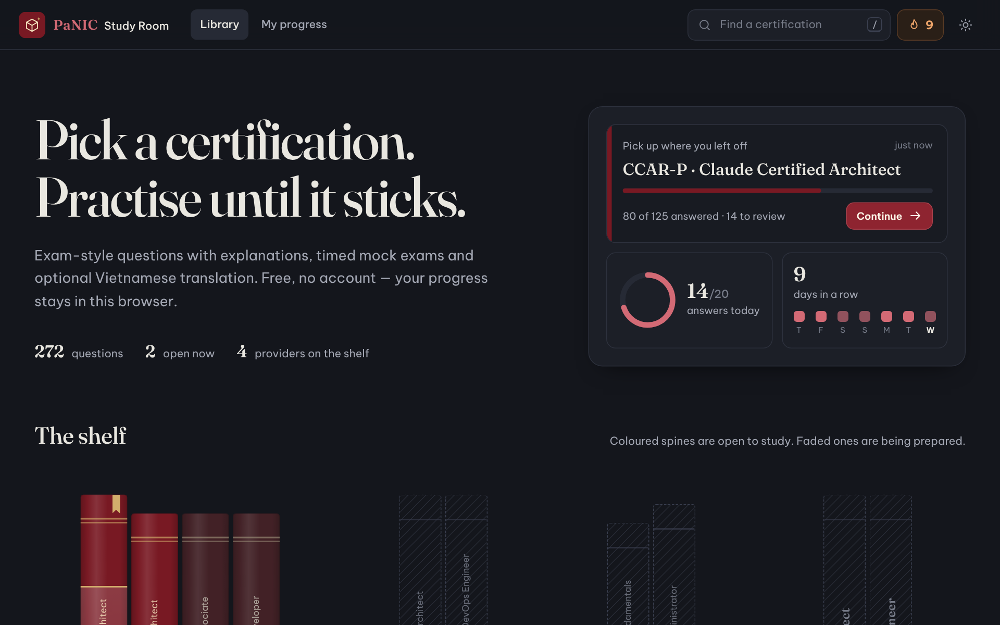</td>
    <td>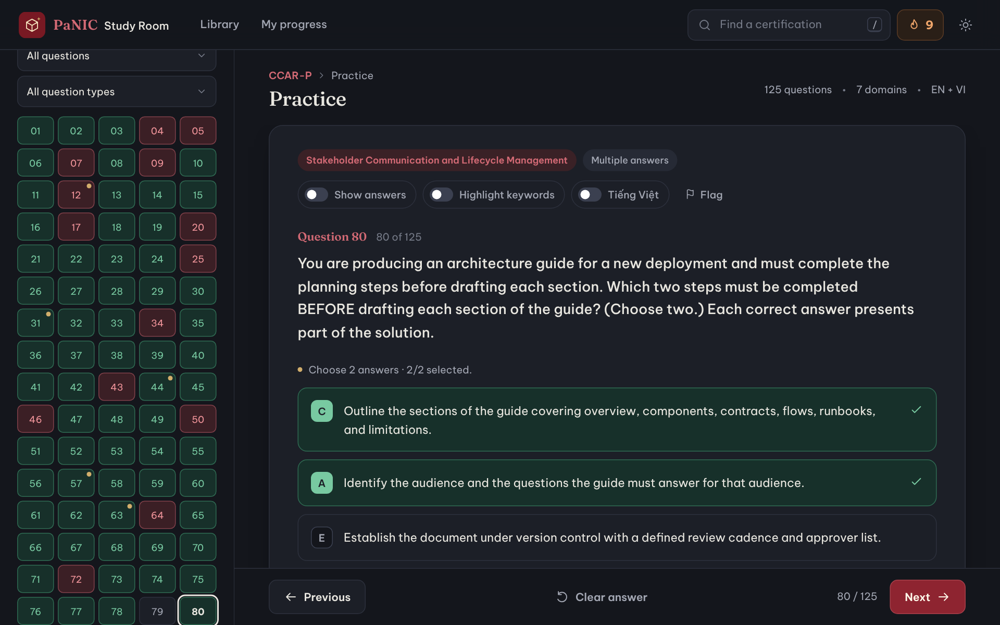</td>
  </tr>
</table>

**Trên điện thoại** — giá sách vuốt ngang, bảng câu hỏi mở dạng ngăn kéo, nút điều hướng luôn trong tầm ngón cái.

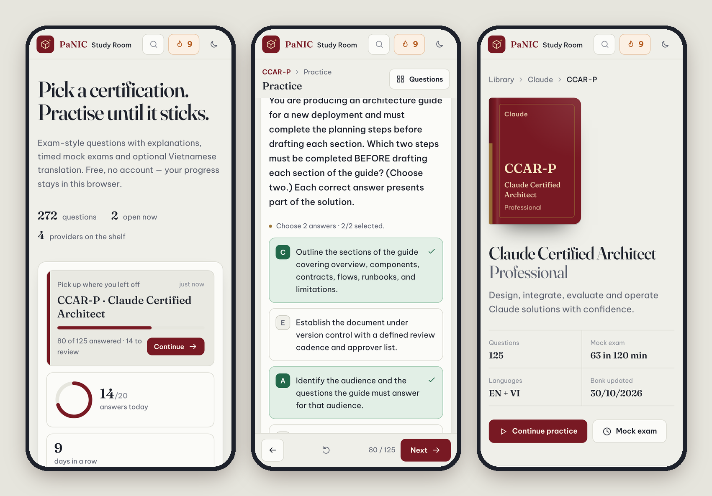

---

## Bắt đầu trong một phút

1. Mở **[panic-study-room.vercel.app](https://panic-study-room.vercel.app)** và chọn một cuốn sách có màu trên kệ.
2. Bấm **Start practice**, trả lời vài câu đầu tiên — vòng tiến độ và chuỗi ngày học bắt đầu đếm.
3. Khi đã làm được phần lớn, vào **Mock exam** để thử sức trong điều kiện có giờ.

Có thể thêm website vào màn hình chính của điện thoại để mở như một ứng dụng.

## Phím tắt

| Phím | Tác dụng |
|---|---|
| `/` hoặc `Ctrl` / `⌘` + `K` | Tìm chứng chỉ |
| `1` – `9` | Chọn đáp án theo thứ tự hiển thị |
| `←` `→` | Câu trước / câu sau |
| `Esc` | Đóng hộp tìm kiếm, hộp thoại hoặc bảng câu hỏi |

## Lưu ý

- PaNIC Study Room là **tài liệu ôn luyện độc lập**, không phải đề thi chính thức và không liên kết với Anthropic, Amazon, Microsoft hay Google. Điểm thi thử chỉ để tham khảo, không phải ngưỡng đỗ chính thức.
- Câu trả lời, đánh dấu và chuỗi ngày học được **lưu trên trình duyệt của bạn**. Dùng thiết bị khác hoặc xoá dữ liệu trình duyệt thì sẽ bắt đầu lại từ đầu.

---

Hướng dẫn thêm chứng chỉ và bộ câu hỏi mới dành cho người quản lý nội dung: [docs/adding-certifications.md](docs/adding-certifications.md).
